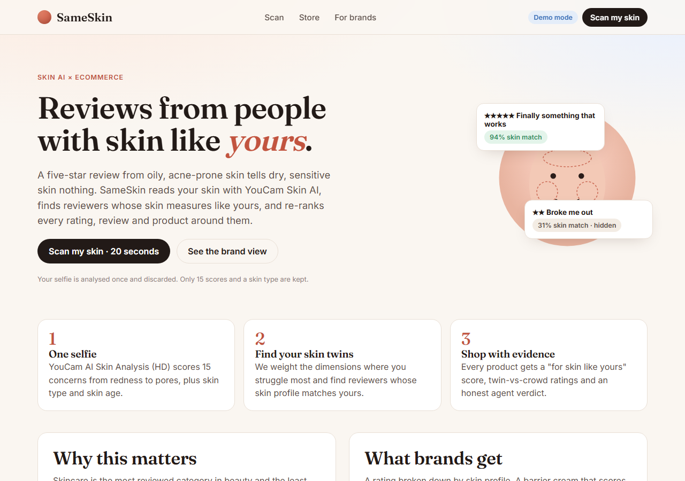
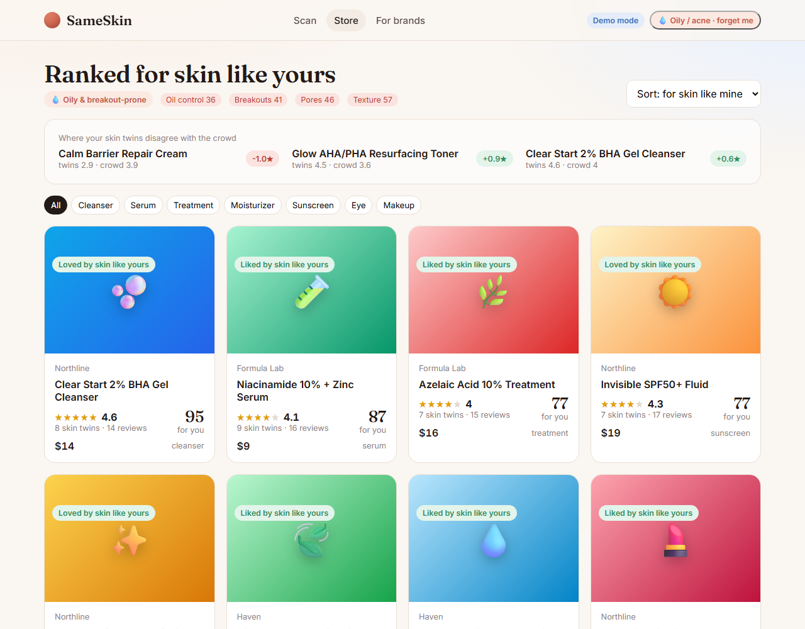
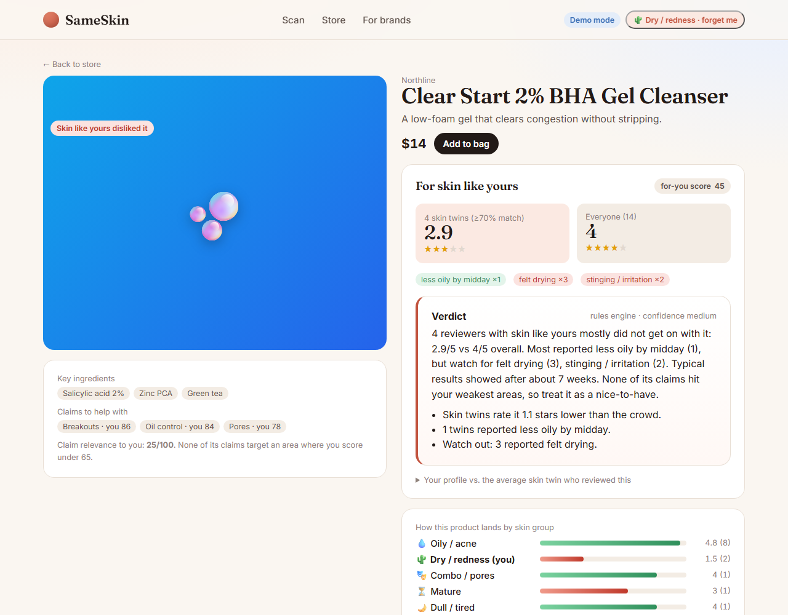
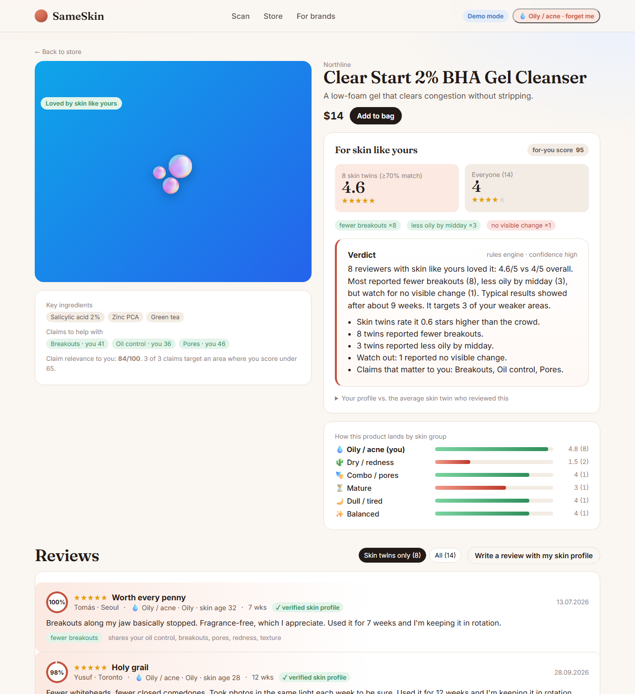
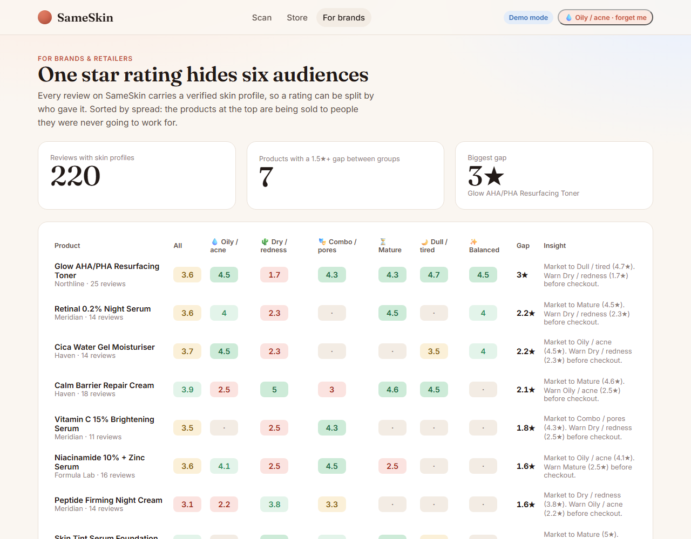
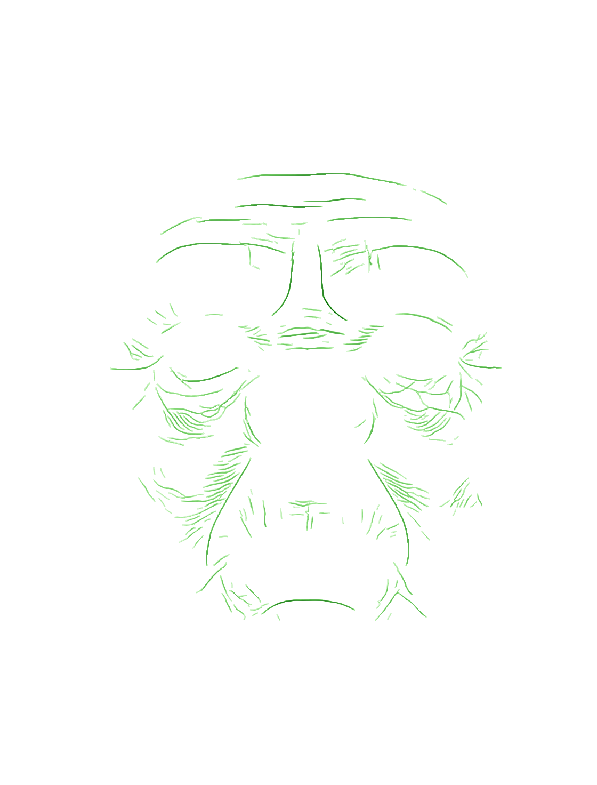
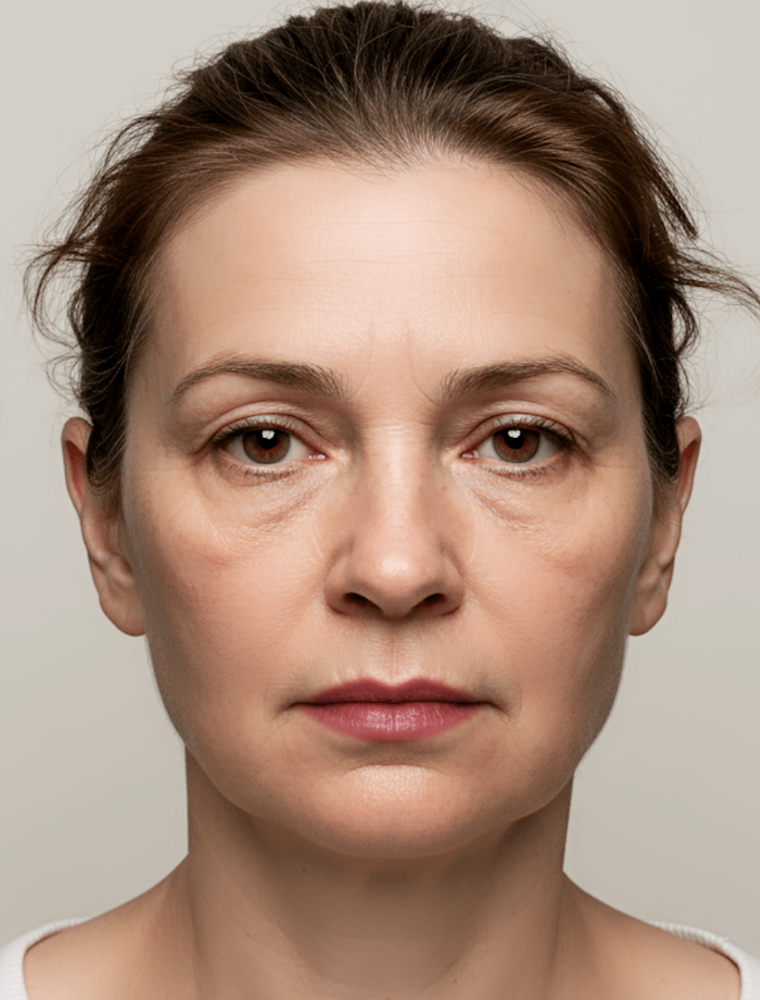

# SameSkin — reviews from people with skin like yours

> One selfie, scored by **YouCam AI Skin Analysis**, turns every skincare review on a store into one that is actually about *your* skin.

**Track:** Skin AI (with an eCommerce bridge) · **YouCam APIs:** AI Skin Analysis HD (core), AI Makeup Virtual Try-On (makeup products) · **Hackathon:** YouCam API Skin AI & eCommerce VTO Hackathon, round 2

**Demo video (2:55):** https://youtu.be/VBO44GROSew · **Devpost:** https://devpost.com/software/1509881



## The problem

Skincare is the most reviewed category in beauty and the least useful to read. "It worked for me" means nothing without knowing whose skin "me" is. A barrier cream that is a 4.8 for dry, reactive skin and a 2.3 for oily, acne-prone skin shows up as a 3.9-star product to everyone, so:

- shoppers buy on blended ratings, get disappointed, return, and leave the one-star review that misleads the next person;
- brands cannot credibly say "works for skin like yours", because nothing on the review ties outcome to skin;
- retailers lose the most valuable signal they have: *who* a product works for.

## What SameSkin does

1. **Scan** — the shopper takes one selfie. YouCam AI Skin Analysis (HD) returns 15 concern scores (redness, oiliness, pores, texture, acne, fine lines, firmness, dark spots, radiance, hydration, dark circles, eye bags, eyelids, tear trough), skin type, skin age and per-concern detection masks. The photo is scored and discarded; only scores are kept.
2. **Find skin twins** — a similarity model that weights the dimensions where either person *struggles* finds reviewers whose skin measures like the shopper's (≥ 70 % similarity).
3. **Re-rank the store** — every product gets a *for skin like yours* score, a twin rating vs. crowd rating, the outcomes twins reported (fewer breakouts ×8, stinging ×3…), and the reviews are sorted and filtered by skin similarity.
4. **Verdict agent** — a Claude tool-use agent pulls the twin reviews, outcome tallies, the shopper's weak spots and ingredient notes, and writes an honest two-sentence verdict with a confidence level. Without an Anthropic key, a deterministic rules engine produces the same structure, so the product always works.
5. **Write a review with your skin attached** — reviews posted after a live scan carry a *verified skin profile* (scores only, no image), which is what makes the matching compound over time.
6. **Brand view** — a rating broken down by six skin-twin groups, sorted by the gap between the best and worst group: the products at the top are being sold to people they were never going to work for.
7. **Try it on** — for makeup products, YouCam Makeup Virtual Try-On renders the shade on the selfie the shopper just scanned.

| Store, re-ranked for an oily, breakout-prone profile | Same product, seen by dry/sensitive skin |
| --- | --- |
|  |  |

| Product page: twins vs. crowd, outcomes, agent verdict | Brand dashboard: one rating, six audiences |
| --- | --- |
|  |  |

The same cleanser is **"Loved by skin like yours" (4.6★) for oily skin** and **"Skin like yours disliked it" (2.9★) for dry skin**. The blended rating is 4.0. That one screen is the whole pitch.

## Run it

Requirements: Node 20+.

```bash
npm install
cp .env.example .env     # DEMO_MODE=true by default: no API key needed
npm run dev              # http://localhost:5173
```

**Demo mode** returns a recorded YouCam-shaped response (three personas) so the full product can be judged without spending API units. Deep links load a persona directly: `/store?persona=dry_sensitive`, `?persona=oily_breakout`, `?persona=mature_firmness`.

**Live mode** (real scans):

```bash
# .env
YOUCAM_API_KEY=your_key       # https://yce.perfectcorp.com/api-console/en/api-keys/
YOUCAM_TIER=HD                # HD = 28 sub-scores, 22 units/scan. SD = 16 units/scan.
DEMO_MODE=false
ANTHROPIC_API_KEY=optional    # enables the Claude verdict agent; omit for the rules engine
```

Other commands: `npm test` (unit tests for the matching engine and YouCam response parsing), `npm run seed` (regenerate the demo catalogue), `npm run build && npm start` (production: one Express server serving the built app on :8787).

## YouCam API usage

| Call | Endpoint | Where |
| --- | --- | --- |
| Register upload | `POST /s2s/v2.0/file` | `server/youcam.ts` → `uploadImage` |
| Upload bytes | `PUT <pre-signed url>` | same |
| Create skin analysis task (16 HD actions) | `POST /s2s/v2.0/task/skin-analysis` | `createSkinTask` |
| Poll result | `GET /s2s/v2.0/task/skin-analysis/{task_id}` | `pollSkinTask` |
| Makeup try-on | `POST /s2s/v2.0/task/makeup-vto` + poll | `server/makeup.ts` |

Parsing is defensive (`toProfile`): it normalises `hd_*` / `_v2` type names, pulls HD region sub-scores (pore: forehead/nose/cheek; wrinkle: forehead/glabellar/crow's feet…), finds the skin-type word wherever the response puts it, keeps mask URLs in memory only, and maps YouCam error codes (`error_lighting_dark`, `error_src_face_too_small`, `CreditInsufficiency`…) to actionable messages for the shopper. Polling never spends units; failed tasks are not billed.

## Verified against the live API

Run on 25 Oct 2026 with a real key against `yce-api-01.makeupar.com`:

| Step | Result |
| --- | --- |
| No-face image → `skin-analysis` | `error_no_face` in 5.2 s, mapped to "We couldn't find a face…", 0 units billed |
| Sample selfie (face too small for HD) | `error_src_face_too_small` in 4.3 s, mapped to "Move closer…", 0 units billed |
| Cropped sample selfie, HD, 16 actions | `success` in 9.9 s: 30 output entries → 15 scores, 3 pore + 7 wrinkle region sub-scores, skin type *Oily*, skin age 51, 15 mask URLs. 22 units |
| Makeup VTO (lip tint) on the same selfie | `success` in 10.1 s, 1 unit |

The real HD response differs from the documented example: every concern arrives as one entry **per region** (`{type:"hd_pore", region:"cheek", ui_score…}` … `region:"whole"`), skin type as `{type:"hd_skin_type", region, skin_type:"Oily"}` and skin age as `{type:"skin_age", score:51}`. The parser handles both shapes; the captured response (mask URLs scrubbed) is the reference fixture at `tests/fixtures/hd_live_response.json`.

| Live wrinkle detection mask | Live makeup try-on result |
| --- | --- |
|  |  |

(The test selfie is Perfect Corp's own sample image from the YouCam API Playground.)

## How the matching works

`shared/matching.ts` is pure and unit-tested.

- **Similarity (0–100).** Per concern, `weight = 0.25` when both people score ≥ 70 (healthy, barely matters), otherwise `1 + (70 − min(score)) / 20` (the worse the weaker person scores, the more that dimension counts). Weighted mean absolute difference → similarity, ±bonus for skin-type agreement, rescaled so that ≥ 70 means "skin twin". Two people who share the same weak spots come out as twins even if their strong dimensions differ.
- **Twin rating.** Similarity-weighted Bayesian average (prior weight 2 toward the global mean), so one enthusiastic twin cannot make a product "loved".
- **Claim fit (0–100).** How much the product's claimed targets overlap the shopper's weak concerns.
- **For-you score** = 0.6 × twin rating + 0.25 × claim fit + 0.15 × confidence (twin count).
- **Verdict**: loved ≥ 4.3 · liked ≥ 3.8 · mixed ≥ 3.0 · otherwise avoid; "few skin twins yet" below 2 twins.

## Architecture

```
shared/    types.ts, matching.ts        domain model + pure matching engine (client & server)
server/    index.ts                     Express API (scan, products, verdict, reviews, brand, vto)
           youcam.ts, makeup.ts         YouCam API clients
           agent.ts                     Claude tool-use agent + rules fallback
           store.ts                     JSON persistence (seed = committed, runtime = git-ignored)
src/       React + Vite front end       Home, Scan, Store, Product, Brand
data/seed  products.json, reviews.json  demo catalogue (generated by scripts/seed.ts)
data/demo  *.json                       recorded-shape YouCam responses for demo mode
tests/     vitest                       matching engine, YouCam response parsing
```

## Reproducing the demo video

The video is recorded by driving the real app in a headless Chrome, with a live YouCam scan and try-on (23 units):

```bash
python scripts/demo/tts.py                     # narration via edge-tts -> docs/video/audio
npm run build && npm start                     # production server on :8787 (live mode)
DEMO_BASE=http://localhost:8787 DEMO_SELFIE=/path/to/selfie.png DEMO_FRAMES=/tmp/frames npx tsx scripts/demo/record.ts
python scripts/demo/assemble.py                # frames + narration -> docs/video/sameskin-demo.mp4
```

`scripts/demo/narration.json` holds the script; `scripts/demo/cards.html` the title and end cards. Requires Python 3 with `edge-tts` and `imageio-ffmpeg`, and Chrome installed.

## Privacy by design

- The selfie is held in server memory for 30 minutes (for mask overlays and try-on) and never written to disk.
- A review stores 15 integers, a skin type and an archetype. No image, no biometrics beyond the scores.
- "Forget me" in the header deletes the profile and the in-memory selfie.

## Honest limitations

- The reviewer population in the demo catalogue is **synthetic**: 220 reviews sampled from six skin archetypes with per-product outcome tendencies (see `scripts/seed.ts`). It exists so the matching engine has a realistic population to demonstrate on. In production every profile comes from a YouCam scan at review time.
- Skin-type labels fall back to a heuristic (oil vs. hydration scores) if the API omits them.
- Not medical advice; this is shopping guidance.

## License

MIT
